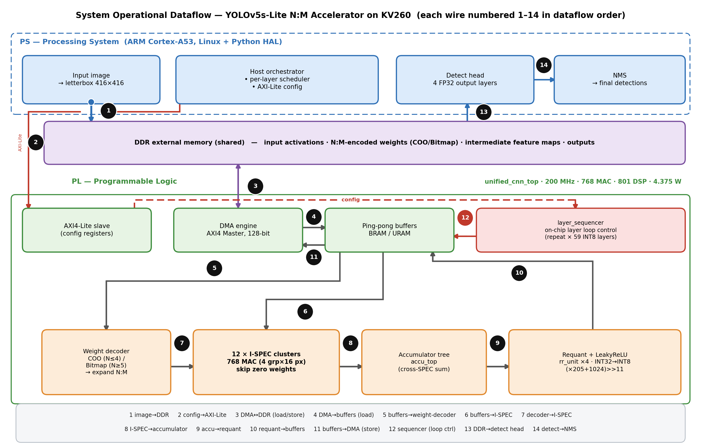

# YOLOv5s N:M Sparse Accelerator on Kria KV260

Bộ tăng tốc phần cứng (RTL Verilog) cho YOLOv5s-Lite INT8 với trọng số thưa N:M theo từng lớp
(kiến trúc kiểu I-SPEC), triển khai trên **Xilinx Kria KV260**, ứng dụng phát hiện chỗ đỗ xe (PKLot).

| Chỉ số | Giá trị (đo trên board) |
|---|---|
| Bitstream | `rev76_build/bd_wrapper_rev174_resident_200.bit` |
| Clock PL | 200 MHz (WNS +0.004 ns) |
| Latency | 0.77 s/frame (416×416) → **1.30 FPS** |
| Kết quả | 106 detection, bit-exact so với golden từng lớp |

Phần cứng chạy conv1×1, conv3×3 và depthwise (sparse N:M, INT8); CPU ARM (numpy) chạy concat/residual,
maxpool, NMS và một số lớp FP32.

## Cấu trúc

| Thư mục | Nội dung |
|---|---|
| `rev76_build/ip_repo/src/` | RTL: `unified_cnn_top` = `dma_engine` + `unified_acc_top` (4× `i_spec`) + `layer_sequencer`, `network_seq`, `graphop_engine`… |
| `rev76_build/*.tcl` | Script build Vivado (block design export trong `tcl_archive/`) |
| `tools/` | Host inference trên board (`inference_unified_v4.py`), đóng gói trọng số, benchmark, test |
| `yolov5/` | Fork Ultralytics YOLOv5 + pipeline nén: DominoSearch N:M per-layer, sparse training, QAT/PTQ |
| `yolov5/runs/quant/extracted_c3/` | Trọng số INT8 N:M đã đóng gói để deploy (`weights_unified_c3_ns12c`) |
| `drivers/dma_region/` | Kernel module Linux cấp vùng CMA cho DMA (`/dev/dma_region`) |
| `golden/` | Input/output tham chiếu từng lớp L00–L62 để verify bit-exact |
| `Docs/` | Hướng dẫn deploy ([How-fpga.md](Docs/How-fpga.md)), hình vẽ, slide & poster |
| `LEVEL_B_DESIGN.md`, `DEBUG_LOG.md` | Thiết kế kiến trúc và nhật ký phát triển/debug chi tiết |

## Chạy trên board

Xem [Docs/How-fpga.md](Docs/How-fpga.md): nạp bitstream → đặt clock 200 MHz → `insmod dma_region.ko` →
chạy `inference_unified_v4.py` với bộ cờ production.

## Dataset

PKLot (Roboflow export, CC BY 4.0) — không kèm trong repo. Tải về và giải nén vào `datasets/pklot/`
theo `datasets/pklot/data.yaml`.

## Tài liệu tham khảo

- I-SPEC: *Efficient Layer-Wise N:M Sparse CNN Accelerator with Flexible …*, Micromachines 2023, 14, 528.
- *DominoSearch* — layer-wise fine-grained N:M sparse scheme search.
- *An FPGA-Based YOLOv5 Accelerator for Real-Time Industrial …*

## License

Thư mục `yolov5/` dựa trên Ultralytics YOLOv5 và tuân theo giấy phép AGPL-3.0 (`yolov5/LICENSE`).
